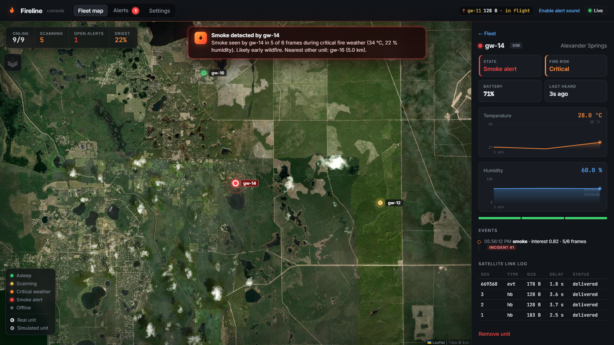
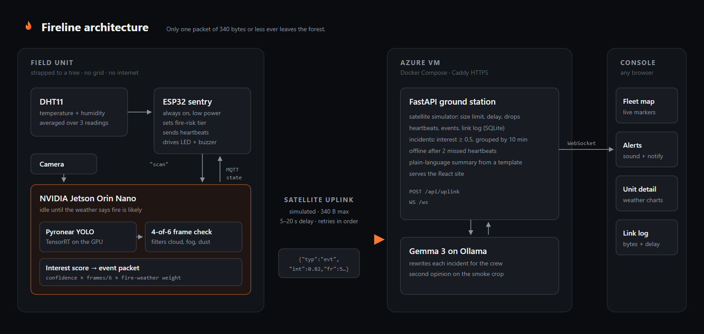

# Fireline

**Satellites see a wildfire once it is big. Fireline sees the first smoke.**

Tree-mounted camera units that spot wildfire smoke on the device, in forests with no power grid, no internet and nobody watching, and send a single alert packet of 340 bytes or less over a satellite link.

<p>
  
  
  
  
  
  
  
  <br>
  
  
  
  
  
  
  
  <br>
  
  
  
  
</p>

<!-- TODO: add the demo video link here once it's uploaded, e.g. [▶ Watch the 90-second demo](https://youtu.be/...) -->



Built at **Knight Hacks IX** (Oct 9–11, 2026).

Florida's dry season is wildfire season: from January 1 to April 13, 2025, the Florida Forest Service counted **1,300 wildfires and 57,025 acres burned** ([FOX 35](https://www.fox35orlando.com/news/florida-wildfire-map-2025)). Satellites that can see small fires pass over a few times a day: VIIRS has about **375 m pixels and 3 to 4 looks a day** at mid-latitudes ([NASA Earthdata](https://www.earthdata.nasa.gov/data/instruments/viirs/viirs-i-band-375-m-active-fire-data)). Ground cameras catch smoke sooner, but today they need a tower, grid power and a data connection. Fireline needs none of them.

## What it does

A cheap humidity sensor decides when it's worth waking the AI. When the air turns hot and dry, the unit's NVIDIA Jetson starts watching for smoke. It confirms the smoke across several frames, scores how worrying it is, and sends one small packet to an operator console that manages the whole flock of units.

- **Smoke detection on the device.** Pyronear's open YOLO smoke model runs on the Jetson's GPU through TensorRT. Smoke has to appear in at least 4 of the last 6 frames, which filters out clouds, fog and dust.
- **Weather-gated wake-up.** An ESP32 reads a DHT11 and sets a fire-risk tier: Low, Elevated or Critical. The Jetson scans every 30 minutes at Low, every 5 minutes at Elevated, and continuously at Critical.
- **Satellite-sized messages.** Every packet fits the 340-byte limit of a short satellite message (Iridium short burst data). In our tests a smoke event is 178 bytes and a heartbeat about 128. Images never go over the satellite link.
- **A live console for the flock.** A fleet map with markers colored by state, alerts with sound and desktop notifications, weather charts for each unit, and a link log that shows each packet's size and satellite delay.
- **Plain-language incident write-ups.** Each incident gets an instant template summary, which Gemma 3 then rewrites for the crew. Gemma also gives a second opinion on the smoke crop.
- **Units that move with the risk.** Units hang from a tree strap, and crews move them as the dry season shifts. A moved unit reports its new mounting spot, and its marker glides there on the map. In the prototype a serial command reports the spot; an NFC tag on each tree is the plan.

## How it works



1. **Sense.** The ESP32 reads the DHT11, averages 3 readings, and changes tier only after 3 readings in a row agree, so one warm gust doesn't flip it.
2. **Wake.** When a scan is due, the ESP32 publishes `unit/scan` over MQTT to the Mosquitto broker on the Jetson.
3. **Detect.** The Jetson grabs a frame every 2 to 3 seconds, keeps the best smoke box from each frame, and computes an interest score:
   ```
   interest = average confidence × (frames with smoke / 6) × fire-weather weight (0.6 / 0.8 / 1.0)
   ```
   At 0.5 or more, it builds an event packet. It keeps scanning while interest stays above 0.2.
4. **Uplink.** The packet goes to `POST /api/uplink` through the satellite simulator. Packets over 340 bytes are rejected, the rest are delivered after a delay, and the unit retries failed packets in order.
5. **Alert.** The server groups events from the same unit within 10 minutes into one incident and pushes it over a WebSocket. Every open console sounds an alarm, shows a notification and flies the map to the unit.

The packet format is the contract between every part of the system: see [docs/protocol.md](docs/protocol.md).

## What's real and what's simulated

- **Real:** the field unit (ESP32, DHT11, Jetson and camera), smoke detection on the device, packet sizes, the web console and Gemma.
- **Simulated:** the satellite link, which has the real 340-byte limit plus an artificial 5–20 s delay and optional drops. Also every unit marked `SIM` on the map; one Jetson can't fill a forest.

## Getting started

You need Python 3.11+ and Node 20+. The console and simulated fleet run on a laptop with no hardware.

```bash
git clone https://github.com/kateye31/jetsonyay.git && cd jetsonyay

# 1. server on http://localhost:8000
cd server
python -m venv .venv
.venv/Scripts/activate          # macOS/Linux: source .venv/bin/activate
pip install -r requirements.txt
uvicorn app.main:app --reload

# 2. console with hot reload on http://localhost:5173 (proxies /api and /ws to :8000)
cd web
npm install
npm run dev

# 3. a simulated fleet in Ocala National Forest, then a smoke alert
python tools/fake_fleet.py fleet --interval 10
python tools/fake_fleet.py event --unit gw-14
```

`npm run build` puts the site in `web/dist`, and then the server alone serves everything on port 8000.

| Command | What it does |
|---|---|
| `DEMO_MODE=1`, or the switch in Settings | Cuts the satellite delay to 1–4 s for live demos |
| `python tools/fake_fleet.py reset` | Clean slate before a demo: clears incidents, events, snapshots and the link log, and keeps units and weather history. Also a button in Settings |
| `GEMMA_BASE_URL=http://localhost:11434/v1 GEMMA_MODEL=gemma3:4b` | Turns on Gemma write-ups through any OpenAI-compatible server, such as a local Ollama. Without it, the template summaries are used |

All settings are listed in [.env.example](.env.example).

**Hardware:** [docs/SETUP.md](docs/SETUP.md) walks through every device in order: laptop, Azure server, phone hotspot, Jetson and ESP32.

## Deploy

One Ubuntu VM on Azure (`Standard_D4s_v5`) runs the whole stack with Docker Compose: the app, Gemma on Ollama, and Caddy for HTTPS. HTTPS matters because browsers only allow desktop notifications on secure origins.

```bash
git clone https://github.com/kateye31/jetsonyay.git && cd jetsonyay/deploy
cp ../.env.example .env      # SITE_ADDRESS=yourdomain.com
docker compose up -d --build
```

Point the field unit at it: `FIRELINE_URL=https://<site> python jetson/scan.py`. See [docs/SETUP.md, step 2](docs/SETUP.md#step-2-the-azure-server-30-min) for each step.

## Repo layout

| Folder | What |
|---|---|
| [`firmware/fireline_sentry/`](firmware/fireline_sentry/) | ESP32 sentry (Arduino): DHT11, fire-risk tiers, scan requests over MQTT, LEDs and buzzer |
| [`jetson/`](jetson/) | Scan loop, interest scoring, packet builder, and an uplink queue that retries in order |
| [`server/`](server/) | FastAPI ground station: satellite simulator, incidents, offline detection, Gemma, WebSocket |
| [`web/`](web/) | React + Vite + Leaflet console: fleet map, alerts, unit detail, settings |
| [`tools/fake_fleet.py`](tools/fake_fleet.py) | Simulated units, hand-fired smoke events, and the demo reset |
| [`deploy/`](deploy/) | Docker Compose for Azure: app, Gemma on Ollama, Caddy |
| [`docs/`](docs/) | [Packet contract](docs/protocol.md), [setup guide](docs/SETUP.md), diagrams |

## Credits

- Smoke model: [Pyronear](https://huggingface.co/pyronear) YOLO models on Hugging Face (Apache 2.0), trained on the Pyro-SDIS dataset of labelled smoke images from fixed ground cameras.
- Incident write-ups: [Gemma 3](https://ai.google.dev/gemma) served by [Ollama](https://ollama.com).
- Map tiles: Esri World Imagery and © OpenStreetMap contributors.

## What's next

- **Tap to place.** An NFC tag on each tree holds its name and coordinates, so a crew sets a unit's location with one tap.
- **Locate the fire.** When two units see the same smoke from different angles, we can triangulate where it is.
- **Share one satellite modem.** Units in a flock can relay to each other over LoRa radio, so only one needs the modem.
- **Real power gating.** Cut the Jetson's power completely between scans and run on solar with a LiFePO4 battery.
- **Test on Florida scenery.** Pyronear's model was trained on other regions' landscapes. It needs testing against local false alarms like dust and prescribed burns.

## Team

<!-- TODO: one line per teammate, e.g. **Name** - Hardware - [@github](https://github.com/username) -->

Contributing: see [CONTRIBUTING.md](CONTRIBUTING.md).
